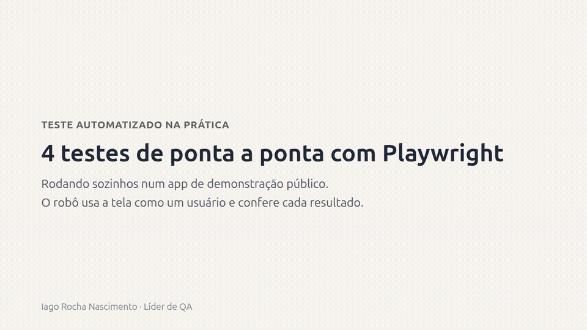

# Playwright TodoMVC demo

[](https://github.com/iagorochanascimentoirn-dev/playwright-todomvc-demo/actions/workflows/playwright.yml)

Suíte de testes de ponta a ponta com Playwright e TypeScript, escrita sobre o [TodoMVC de demonstração](https://demo.playwright.dev/todomvc/) que o próprio Playwright mantém público.

Trabalho com QA de sistemas web de órgãos públicos e o código de lá não pode ser aberto. Este repositório existe para mostrar, num app que qualquer pessoa pode acessar, o jeito como organizo uma suíte no dia a dia.



## O que tem aqui

- **15 testes** em 5 grupos: cadastro, conclusão, filtros, edição e persistência.
- **3 projetos**: Chrome, Firefox e um celular emulado (Pixel 7). São 45 execuções por rodada.
- **Page object** em `pages/TodoPage.ts`. Os métodos descrevem o que o usuário faz; as verificações ficam nos testes, para dar para ler o teste sem abrir outro arquivo.
- **Fixture** em `tests/fixtures.ts` que entrega a página já aberta. Cada teste roda num contexto novo do navegador, então um teste não depende do outro.
- **Teste por tabela** nos filtros: os três filtros têm a mesma estrutura, muda só a entrada e o esperado.
- **Conferência do dado gravado**, além da tela. Os testes de persistência leem o `localStorage` antes de recarregar a página.
- **CI no GitHub Actions** com checagem de tipos, um job por navegador e o relatório HTML guardado como artefato. Roda também toda segunda de manhã, porque o app é externo e pode mudar sem aviso.

## Algumas decisões

**Sem retry.** `retries: 0` de propósito. Um teste que só passa na segunda tentativa está me avisando de alguma coisa: espera errada, dado compartilhado, ou um defeito intermitente de verdade. Com retry ligado esse aviso some. Antes de publicar rodei a suíte 5 vezes seguidas (`--repeat-each=5`, 225 execuções) sem nenhuma falha.

**Sem espera fixa.** Nenhum `waitForTimeout`. Quem espera são as asserções do Playwright (`toHaveText`, `toHaveCount`) e o `expect.poll` quando o dado não está na tela.

**Localizador pelo que o usuário vê.** Placeholder, papel e nome acessível (`getByRole`, `getByLabel`, `getByPlaceholder`). O `getByTestId` entra só onde o próprio app expõe `data-testid` para a lista.

**`forbidOnly` no CI.** Um `test.only` esquecido faz o CI falhar em vez de rodar meia suíte e ficar verde.

## Como rodar

```bash
npm ci
npx playwright install chromium firefox
npm test                 # todos os projetos
npm run test:headed      # só Chrome, com o navegador aberto
npm run report           # abre o último relatório
```

Requer Node 20 ou mais novo.

## Estrutura

```
pages/TodoPage.ts        page object
tests/fixtures.ts        fixture que abre a página
tests/tarefas.spec.ts    os testes
playwright.config.ts     projetos, trace e relatório
.github/workflows/       CI
```
